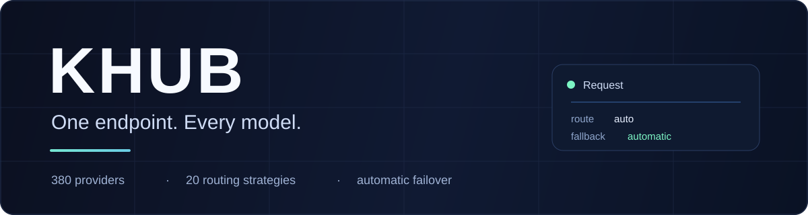

<div align="center">



</div>

# KHUB

**One endpoint. Every model.**

KHUB is a self-hosted AI gateway. It puts OpenAI-, Claude-, and Gemini-compatible APIs in front of 380 providers, then routes every request to the model that should answer it — and fails over automatically when a provider slows down, runs out of quota, or drops a connection.

Run it on a laptop, a VPS, or in a container. Bring your own provider accounts and keep the keys on your infrastructure.

[Quick start](#quick-start) · [Why KHUB](#why-khub) · [Routing](#routing-and-resilience) · [Documentation](#documentation)

---

## Quick start

### Docker Compose

```bash
cp .env.example .env
docker compose --profile base up -d
```

- Dashboard: `http://localhost:20128`
- API base URL: `http://localhost:20129/v1`

Set `INITIAL_PASSWORD` in `.env` before the first boot. `.env.example` ships the placeholder
`CHANGEME`; the server warns if it is still in place. `JWT_SECRET`, `API_KEY_SECRET`, and
`STORAGE_ENCRYPTION_KEY` are provisioned automatically on first use and persisted under `DATA_DIR`,
so restarts and upgrades keep the same keys.

The `base` profile builds a minimal image with no provider CLIs. Pick another profile when you need
more:

| Profile | Use it for                                                         |
| ------- | ------------------------------------------------------------------ |
| `base`  | Headless gateway, smallest image                                   |
| `web`   | Browser-backed providers (`gemini-web`, `claude-web`, and similar) |
| `cli`   | Bundled coding CLIs inside the container                           |
| `host`  | Mount host CLI binaries (Linux only)                               |

### From source

```bash
cp .env.example .env
npm install
npm run dev
```

The dev server serves the dashboard and the API on `http://localhost:20128`.

For a production build:

```bash
npm run build
npm start
```

Requires Node `>=22.22.2 <23 || >=24.0.0 <27`.

### Desktop app

```bash
npm install
npm run electron:dev
```

Build an installer for the host platform with `npm run electron:build`, or target one explicitly:

```bash
npm run electron:build:linux   # AppImage + DEB (x64, arm64)
npm run electron:build:mac     # DMG
npm run electron:build:win     # NSIS installer + portable (x64)
```

---

## Why KHUB

Every tool you use speaks a different API. Every provider has a different key, quota, and failure
mode. KHUB collapses that into one service you control.

**One endpoint for every client.** Point Claude Code, Codex, Cursor, Cline, Copilot, or any SDK at a
single base URL. KHUB translates OpenAI, Claude, and Gemini wire formats in both directions.

**Automatic failover.** When a target errors, rate-limits, or stalls, KHUB moves the request to the
next healthy target. The client sees one continuous response.

**Provider sprawl, handled.** One catalog, one credential store, one usage ledger for 380 providers —
instead of a folder of `.env` files and a different SDK per vendor.

**Cost and latency control.** Route by price, remaining quota, context window, cache affinity, or
observed latency. Cap spend per key, per team, or per model.

---

## Routing and resilience

### `auto` picks the target

Send `model: "auto"` and KHUB scores every eligible target across 16 factors, including price,
quota headroom, health, latency, context fit, and tier priority. Narrow it when you have a
preference:

```json
{ "model": "auto/coding" }
```

```json
{ "model": "auto/cheap" }
```

### 20 routing strategies

Persist a combo when you want explicit control. The strategy table is declared in
`src/shared/constants/routingStrategies.ts`.

| Group          | Strategies                                                                |
| -------------- | ------------------------------------------------------------------------- |
| Ordered        | `priority`, `weighted`, `round-robin`, `fill-first`                       |
| Selection      | `p2c`, `random`, `least-used`, `strict-random`                            |
| Quota-aware    | `reset-aware`, `reset-window`, `headroom`, `quota-weighted`               |
| Workload-aware | `cost-optimized`, `context-optimized`, `cache-optimized`, `context-relay` |
| Adaptive       | `auto`, `lkgp`, `fusion`, `pipeline`                                      |

`fusion` fans a request out to a panel of models and has a judge model synthesize the final answer.
`pipeline` runs staged work across targets.

### Three independent resilience layers

KHUB keeps failure scopes separate, so one bad account never disables a provider.

| Layer                    | Scope                         | What it does                                                               |
| ------------------------ | ----------------------------- | -------------------------------------------------------------------------- |
| Provider circuit breaker | Whole provider                | Opens after repeated provider-level failures; half-opens to probe recovery |
| Connection cooldown      | One account or key            | Skips a rate-limited credential with exponential backoff                   |
| Model lockout            | Provider + connection + model | Removes one failing model without touching the rest of the connection      |

Transient statuses (`408`, `500`, `502`, `503`, `504`) trip the provider breaker. Most `401`, `403`,
and `429` responses belong to a connection cooldown or a model lockout instead.

Deep dives: [Auto-Combo routing](docs/routing/AUTO-COMBO.md) ·
[Resilience guide](docs/architecture/RESILIENCE_GUIDE.md).

---

## Providers and models

The catalog currently ships **380 providers**. Fifty-four of them have a free tier that renews or
needs no key at all. The rest are API-key, OAuth, web-cookie, local, or upstream-proxy providers.

Models are addressed as `provider/model`:

```text
anthropic/claude-sonnet-4-5
openai/gpt-5
google/gemini-2.5-pro
groq/llama-3.3-70b-versatile
ollama/qwen3-coder
```

Browse the full list in the dashboard under **Providers**, or read the generated
[provider reference](docs/reference/PROVIDER_REFERENCE.md).

---

## One API for every client

| Compatibility | Endpoint                                              |
| ------------- | ----------------------------------------------------- |
| OpenAI        | `POST /v1/chat/completions`                           |
| OpenAI        | `POST /v1/completions`, `POST /v1/embeddings`         |
| OpenAI        | `GET /v1/models`, `POST /v1/responses`                |
| Claude        | `POST /v1/messages`, `POST /v1/messages/count_tokens` |
| Gemini        | `POST /v1beta/models/{model}:generateContent`         |
| Gemini        | `POST /v1beta/models/{model}:streamGenerateContent`   |

```bash
# KHUB_API_URL is the API base from Quick start (it already includes /v1):
#   from source → http://localhost:20128/v1   |   Docker Compose → http://localhost:20129/v1
curl "$KHUB_API_URL/chat/completions" \
  -H "Authorization: Bearer $KHUB_API_KEY" \
  -H "Content-Type: application/json" \
  -d '{
    "model": "auto",
    "messages": [{ "role": "user", "content": "Explain this stack trace." }],
    "stream": true
  }'
```

Streaming works across every compatibility layer. Multi-modal routes cover images, audio, speech,
transcription, video, music, OCR, rerank, and moderation.

Full reference: [API_REFERENCE.md](docs/reference/API_REFERENCE.md) ·
[OpenAPI spec](docs/openapi.yaml).

---

## Observability and cost

Every request is recorded with its provider, model, token counts, latency, cache result, and cost.
The dashboard exposes the data at:

| Page                   | What it answers                                           |
| ---------------------- | --------------------------------------------------------- |
| `/dashboard/logs`      | What was sent, what came back, which target served it     |
| `/dashboard/usage`     | Token and request volume per key, provider, and model     |
| `/dashboard/costs`     | Spend, budgets, and per-team attribution                  |
| `/dashboard/analytics` | Routing mix, fallback rate, compression, and combo health |

Successful responses also carry cost and routing telemetry in response headers, so clients can log
spend without a second API call. Semantic caching is available and can be bypassed per request.

Compression is built in: 12 engines, including RTK for command output and Caveman for language-aware
rule packs. Stacked together they cut prompt tokens on eligible workloads. See the
[compression guide](docs/compression/COMPRESSION_GUIDE.md).

---

## Security

- **Credentials at rest.** Provider keys and OAuth tokens are encrypted with AES-256-GCM
  (`src/lib/db/encryption.ts`). Keys never appear in logs or error bodies.
- **Gateway auth.** Set `REQUIRE_API_KEY=true` to reject anonymous traffic. Issue scoped keys from
  the dashboard and cap them by spend, model access, or rate.
- **Local-first.** Docker Compose publishes ports on `127.0.0.1` by default. Set `APP_BIND_HOST`
  only when you intentionally expose the gateway, and split the dashboard and API onto separate
  ports with `DASHBOARD_PORT` and `API_PORT` when you need network isolation.
- **Guardrails.** Prompt-injection detection, PII masking, and modality bridges run before and
  after the upstream call. PII redaction and response sanitization are opt-in and off by default.
- **Error hygiene.** Responses are sanitized; stack traces stay server-side.

Details: [Guardrails](docs/security/GUARDRAILS.md) ·
[Error sanitization](docs/security/ERROR_SANITIZATION.md).

---

## Agent protocols

**MCP server.** 110 tools across 33 scopes, served over stdio, SSE, or Streamable HTTP. Claude
Desktop, Cursor, and any MCP client can drive providers, combos, memory, skills, and the request
log through the gateway. See [MCP-SERVER.md](docs/frameworks/MCP-SERVER.md).

**A2A.** A JSON-RPC 2.0 agent endpoint with six registered skills: provider discovery, smart
routing, quota management, cost analysis, health reporting, and capability listing. See
[A2A-SERVER.md](docs/frameworks/A2A-SERVER.md).

**Skills.** A 45-entry catalog of API, CLI, and config skills that agents can discover and execute.
See [SKILLS.md](docs/frameworks/SKILLS.md).

**Memory.** Persistent conversational memory keyed by API key, backed by SQLite FTS5 with an
optional Qdrant tier for semantic and hybrid retrieval. Memory is off by default; enable it under
**Settings → Memory**. See [MEMORY.md](docs/frameworks/MEMORY.md).

---

## Desktop

The Electron app runs the same gateway and dashboard as a native window, with a tray menu and a
built-in server lifecycle. Build targets are Linux (AppImage, DEB), macOS (DMG), and Windows (NSIS
installer, portable).

```bash
npm run electron:dev
npm run electron:build
```

Platform notes and signing: [ELECTRON_GUIDE.md](docs/guides/ELECTRON_GUIDE.md).

---

## Documentation

| Start here        | Link                                                          |
| ----------------- | ------------------------------------------------------------- |
| Self-hosting      | [SELF_HOST_GUIDE.md](docs/getting-started/SELF_HOST_GUIDE.md) |
| Docker            | [DOCKER_GUIDE.md](docs/guides/DOCKER_GUIDE.md)                |
| Architecture      | [ARCHITECTURE.md](docs/architecture/ARCHITECTURE.md)          |
| API reference     | [API_REFERENCE.md](docs/reference/API_REFERENCE.md)           |
| Provider catalog  | [PROVIDER_REFERENCE.md](docs/reference/PROVIDER_REFERENCE.md) |
| Themes            | [KHUB_THEMES.md](docs/guides/KHUB_THEMES.md)                  |
| All documentation | [docs/README.md](docs/README.md)                              |

---

## Contributing

Read [CONTRIBUTING.md](CONTRIBUTING.md) before opening a pull request. In short: branch from the
active release branch, keep changes scoped, add tests for production code, and run the focused
checks for the area you touched.

```bash
npm run lint
npm run typecheck:core
npm run test:unit
```

---

## License

KHUB is released under the [MIT License](LICENSE).

Copyright © 2026 diegosouzapw.

---

## Thank you

KHUB builds on the OmniRoute project and the people who made it. Thank you to every contributor who
shaped it.
